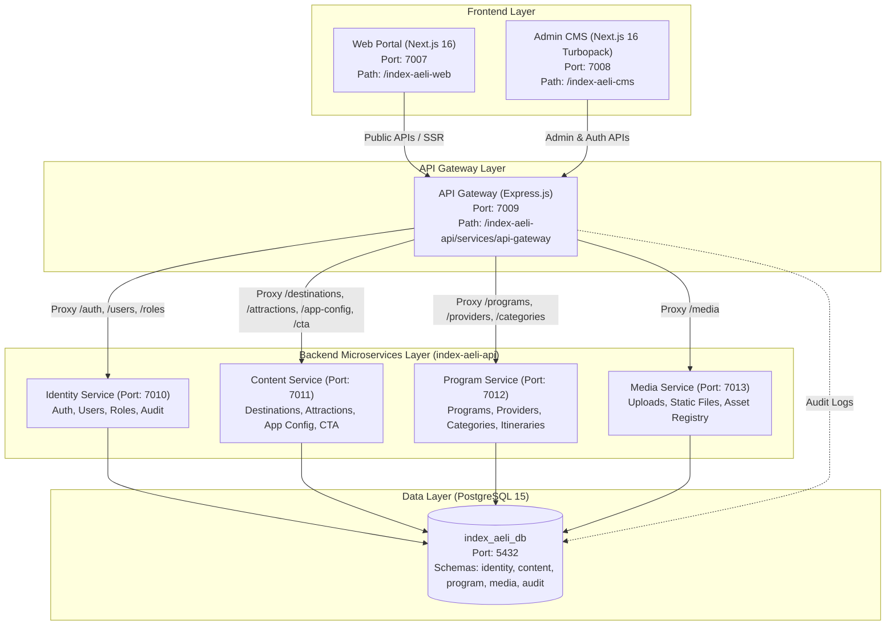

# INDEX-AELI Master Architecture & Agent Vibecoding Guide

> **Important Notice for AI Coding Agents**:
> This document is the **Single Source of Truth** for the entire **INDEX-AELI Platform**.
> Read this file thoroughly before planning changes, creating features, or debugging bugs. It contains the complete system architecture, data models, API contracts, RBAC matrices, common pitfalls, and operational procedures.

---

## 🧭 1. High-Level System Architecture

INDEX-AELI is a full-stack tourism and experiential travel platform consisting of three primary applications and a shared PostgreSQL database:



### Port Allocations & Environment Mapping
| Component | Local Port | Internal Docker URL | Tech Stack | Responsibility |
| :--- | :--- | :--- | :--- | :--- |
| **PostgreSQL** | `5432` | `postgres://...:5432/index_aeli_db` | Postgres 15 Alpine | Multi-schema centralized database |
| **API Gateway** | `7009` | `http://api-gateway:7009` | Express, TypeScript | Auth middleware, Proxying, Rate limiting, Audit logs |
| **Identity Service** | `7010` | `http://identity-service:7010` | Express, pg, bcrypt, JWT | Authentication, RBAC, User lifecycle, Permanent cascade delete |
| **Content Service** | `7011` | `http://content-service:7011` | Express, pg | Destinations, Attractions, App Config, CTA banners |
| **Program Service** | `7012` | `http://program-service:7012` | Express, pg | Travel programs, Itinerary stops, Rundowns, Quotas, Providers, Categories |
| **Media Service** | `7013` | `http://media-service:7013` | Express, Multer, pg | Static uploads (`/uploads/`), Media asset tracking |
| **Admin CMS** | `7008` | `http://cms:7008` | Next.js 16 (Turbopack), React 19, Tailwind v4, Base UI | Internal dashboard for managing content, programs, users, config |
| **Public Web** | `7007` | `http://web:7007` | Next.js 16, React 19, Tailwind v4, Framer Motion | Traveler-facing website, Discovery, Booking flow |

---

## 🗄️ 2. Database Schema & Entity Relationships

The PostgreSQL database `index_aeli_db` uses PostgreSQL schemas to namespace domains while preserving cross-service transactionality.

### 2.1. Schema Breakdown

#### Schema `identity`
- **`identity.users`**:
  - `id UUID PRIMARY KEY DEFAULT gen_random_uuid()`
  - `email VARCHAR(255) UNIQUE NOT NULL`
  - `password_hash VARCHAR(255) NOT NULL`
  - `name VARCHAR(255)`
  - `phone VARCHAR(50)`
  - `bio TEXT`
  - `role VARCHAR(50) NOT NULL DEFAULT 'content_editor'` (`super_admin` | `admin` | `content_editor` | `viewer`)
  - `status VARCHAR(50) NOT NULL DEFAULT 'active'` (`active` | `inactive`)
  - `notification_preferences JSONB DEFAULT '{"email": true, "security": true, "updates": true, "marketing": false}'`
  - `created_at TIMESTAMP NOT NULL DEFAULT NOW()`
  - `updated_at TIMESTAMP NOT NULL DEFAULT NOW()`

- **`identity.notifications`**:
  - `id UUID PRIMARY KEY DEFAULT gen_random_uuid()`
  - `user_id UUID` (Nullable; if null, broadcast)
  - `title VARCHAR(255) NOT NULL`
  - `message TEXT NOT NULL`
  - `type VARCHAR(50) NOT NULL DEFAULT 'info'` (`info` | `success` | `warning` | `security`)
  - `link VARCHAR(255)`
  - `is_read BOOLEAN NOT NULL DEFAULT false`
  - `created_at TIMESTAMP NOT NULL DEFAULT NOW()`

- **`identity.billing_profiles`**:
  - `id UUID PRIMARY KEY DEFAULT gen_random_uuid()`
  - `user_id UUID`
  - `plan_name VARCHAR(100) NOT NULL DEFAULT 'INDEX-AELI Operator Pro'`
  - `billing_cycle VARCHAR(50) NOT NULL DEFAULT 'monthly'` (`monthly` | `yearly`)
  - `status VARCHAR(50) NOT NULL DEFAULT 'active'`
  - `renewal_date DATE DEFAULT (CURRENT_DATE + INTERVAL '30 days')`
  - `payment_methods JSONB`
  - `invoices JSONB`
  - `created_at TIMESTAMP DEFAULT NOW()`, `updated_at TIMESTAMP DEFAULT NOW()`

- **`identity.payout_profiles`**:
  - `id UUID PRIMARY KEY DEFAULT gen_random_uuid()`
  - `user_id UUID`
  - `available_balance NUMERIC(15, 2)` (Saldo siap ditransfer/ditarik)
  - `pending_balance NUMERIC(15, 2)` (Dana booking dalam kliring)
  - `total_paid_out NUMERIC(15, 2)` (Total dana telah berhasil dicairkan ke bank)
  - `auto_payout_enabled BOOLEAN DEFAULT true` (Transfer otomatis aktif)
  - `auto_payout_schedule VARCHAR(50) DEFAULT 'daily'` (`daily` | `weekly` | `monthly`)
  - `bank_accounts JSONB` (Daftar rekening bank terverifikasi, nomor rekening, atas nama, rekening utama)
  - `recent_purchases JSONB` (Pemasukan dari pemesanan program tour wisatawan)
  - `payout_history JSONB` (Mutasi histori pencairan/disbursement ke rekening bank)
  - `created_at TIMESTAMP DEFAULT NOW()`, `updated_at TIMESTAMP DEFAULT NOW()`

#### Schema `content`
- **`content.destinations`**:
  - `id UUID PRIMARY KEY DEFAULT gen_random_uuid()`
  - `name VARCHAR(255) NOT NULL`
  - `slug VARCHAR(255) UNIQUE NOT NULL`
  - `description TEXT NOT NULL`
  - `overview TEXT`
  - `best_time_to_visit VARCHAR(255)`
  - `is_popular BOOLEAN DEFAULT false`
  - `status VARCHAR(50) DEFAULT 'published'` (`draft` | `published` | `archived`)
  - `image VARCHAR(500)`
  - `gallery TEXT[]`
  - `capital VARCHAR(255)`, `population VARCHAR(255)`, `language VARCHAR(255)`, `timezone VARCHAR(255)`
  - `weather_temperature VARCHAR(255)`, `weather_condition VARCHAR(255)`
  - `created_by UUID`, `updated_by UUID`
  - `created_at TIMESTAMP DEFAULT NOW()`, `updated_at TIMESTAMP DEFAULT NOW()`

- **`content.attractions`**:
  - `id UUID PRIMARY KEY DEFAULT gen_random_uuid()`
  - `destination_id UUID REFERENCES content.destinations(id) ON DELETE CASCADE`
  - `name VARCHAR(255) NOT NULL`
  - `slug VARCHAR(255) UNIQUE NOT NULL`
  - `location_label VARCHAR(255) NOT NULL`
  - `description TEXT NOT NULL`
  - `about TEXT`, `historical_background TEXT`, `operational_hours VARCHAR(255)`
  - `latitude DECIMAL`, `longitude DECIMAL`, `entrance_access_info TEXT`, `facilities TEXT[]`
  - `status VARCHAR(50) DEFAULT 'published'` (`draft` | `published` | `archived`)
  - `image VARCHAR(500)`
  - `gallery TEXT[]`
  - `created_by UUID`, `updated_by UUID`
  - `created_at TIMESTAMP DEFAULT NOW()`, `updated_at TIMESTAMP DEFAULT NOW()`

- **`content.app_config`**:
  - `id INTEGER PRIMARY KEY` (Single-row pattern: ID = 1)
  - `config JSONB NOT NULL` (Stores: `tax_percent`, `credentials`, `contact`, `about`, `footer`)
  - `updated_at TIMESTAMP DEFAULT NOW()`

- **`content.cta_sections`**:
  - `id UUID PRIMARY KEY DEFAULT gen_random_uuid()`
  - `scope VARCHAR(100) NOT NULL`
  - `title VARCHAR(255) NOT NULL`, `subtitle TEXT`, `bg_image_url VARCHAR(500)`
  - `primary_btn_text VARCHAR(100)`, `primary_btn_url VARCHAR(255)`
  - `secondary_btn_text VARCHAR(100)`, `secondary_btn_url VARCHAR(255)`
  - `is_active BOOLEAN DEFAULT true`

#### Schema `program`
- **`program.providers`**:
  - `id UUID PRIMARY KEY DEFAULT gen_random_uuid()`
  - `legal_name VARCHAR(255) UNIQUE NOT NULL`
  - `display_name VARCHAR(255)`
  - `contact_info JSONB`
  - `status VARCHAR(50) DEFAULT 'active'`

- **`program.programs`**:
  - `id UUID PRIMARY KEY DEFAULT gen_random_uuid()`
  - `provider_id UUID REFERENCES program.providers(id) ON DELETE CASCADE`
  - `destination_id UUID` (Refers to `content.destinations(id)`)
  - `attraction_id UUID` (Refers to `content.attractions(id)`)
  - `name VARCHAR(255) NOT NULL`
  - `category VARCHAR(100) NOT NULL`
  - `location_label VARCHAR(255) NOT NULL`
  - `short_description TEXT NOT NULL`, `overview TEXT`, `highlights TEXT[]`
  - `price_min DECIMAL`, `price_max DECIMAL`, `price_unit VARCHAR(100)`, `price_note TEXT`
  - `duration_label VARCHAR(100) NOT NULL`
  - `max_guest_min INTEGER`, `max_guest_max INTEGER`, `min_quota INTEGER`, `max_quota INTEGER`
  - `meeting_point VARCHAR(255)`
  - `rating DECIMAL DEFAULT 0.0`, `reviews_count INTEGER DEFAULT 0`
  - `status VARCHAR(50) DEFAULT 'published'` (`draft` | `published` | `archived`)
  - `image VARCHAR(500)`, `gallery TEXT[]`
  - `date_availability VARCHAR(50) DEFAULT 'all_days'` (`all_days` | `specific_days` | `date_list`)
  - `available_dates TEXT[]`
  - `created_by UUID`, `updated_by UUID`

- **`program.itinerary_stops`**:
  - `id UUID PRIMARY KEY DEFAULT gen_random_uuid()`
  - `program_id UUID REFERENCES program.programs(id) ON DELETE CASCADE`
  - `order_index INTEGER NOT NULL`, `location_name VARCHAR(255) NOT NULL`, `unique_feature TEXT`, `activity_challenge TEXT`

- **`program.rundown_items`**:
  - `id UUID PRIMARY KEY DEFAULT gen_random_uuid()`
  - `program_id UUID REFERENCES program.programs(id) ON DELETE CASCADE`
  - `time_slot VARCHAR(100) NOT NULL`, `activity_title VARCHAR(255) NOT NULL`, `description TEXT`, `order_index INTEGER DEFAULT 0`

- **`program.include_exclude_items`**:
  - `id UUID PRIMARY KEY DEFAULT gen_random_uuid()`
  - `program_id UUID REFERENCES program.programs(id) ON DELETE CASCADE`
  - `type VARCHAR(50) NOT NULL` (`include` | `exclude`), `description TEXT NOT NULL`

- **`program.categories`**:
  - `id UUID PRIMARY KEY DEFAULT gen_random_uuid()`
  - `name VARCHAR(100) UNIQUE NOT NULL`
  - `description TEXT`, `color VARCHAR(255)`, `gradient VARCHAR(255)`

#### Schema `media`
- **`media.media_assets`**:
  - `id UUID PRIMARY KEY DEFAULT gen_random_uuid()`
  - `owner_type VARCHAR(100) NOT NULL` (`destination` | `attraction` | `program`)
  - `owner_id UUID NOT NULL`
  - `url VARCHAR(500) NOT NULL`, `type VARCHAR(50) NOT NULL` (`photo` | `video`), `caption VARCHAR(255)`, `order_index INTEGER`

#### Schema `audit`
- **`audit.audit_logs`**:
  - `id UUID PRIMARY KEY DEFAULT gen_random_uuid()`
  - `actor_id UUID`, `entity_type VARCHAR(100)`, `entity_id UUID`, `action VARCHAR(50)`, `diff JSONB`, `created_at TIMESTAMP DEFAULT NOW()`

---

## 🔐 3. Authentication, RBAC & Request Lifecycle

```mermaid
sequenceDiagram
    autonumber
    actor User as User / Admin
    participant CMS as Next.js CMS (Port 7008)
    participant GW as API Gateway (Port 7009)
    participant Micro as Service (7010-7013)
    participant DB as PostgreSQL (5432)

    User->>CMS: Login (email, password)
    CMS->>GW: POST /api/v1/auth/login
    GW->>Micro: Proxy to Identity Service
    Micro->>DB: Check identity.users & verify bcrypt
    Micro-->>CMS: Returns JWT Token & User payload
    CMS->>CMS: Set 'session_token' & 'user' in Cookies

    Note over User,CMS: Subsequent Authenticated Requests
    User->>CMS: Access /dashboard/programs
    CMS->>GW: GET /api/v1/admin/programs (Header: Bearer Token)
    GW->>GW: authMiddleware verifies JWT
    GW->>GW: Injects x-user-id, x-user-role, x-user-email
    GW->>Micro: Forwards request to Program Service
    Micro->>Micro: checkEditorRole verifies x-user-role
    Micro->>DB: Query program.programs
    Micro-->>GW-->>CMS-->>User: Returns programs list
    opt Write Action (POST, PUT, PATCH, DELETE)
        GW->>DB: auditLoggingMiddleware logs into audit.audit_logs
    end
```

### 3.1. Role Matrix & Permissions
| Capability | `super_admin` | `admin` | `content_editor` | `viewer` | Public |
| :--- | :---: | :---: | :---: | :---: | :---: |
| **Public Site View** (Web) | ✅ | ✅ | ✅ | ✅ | ✅ |
| **CMS Login Access** | ✅ | ✅ | ✅ | ✅ | ❌ |
| **Overview & Reports** | ✅ | ✅ | ✅ | ✅ | ❌ |
| **Location / Destinations** (View, Create, Edit) | ✅ | ✅ | ✅ | ❌ | ❌ |
| **Experience / Attractions** (View, Create, Edit) | ✅ | ✅ | ✅ | ❌ | ❌ |
| **Programs** (View, Create, Edit, Calendar) | ✅ | ✅ | ✅ | ❌ | ❌ |
| **Categories & Providers** (View, Create, Edit) | ✅ | ✅ | ✅ | ❌ | ❌ |
| **Publish / Archive Status** | ✅ | ✅ | ❌ (Draft only) | ❌ | ❌ |
| **User Access Menu** (`/dashboard/users`, `/roles`) | ✅ | ✅ | ❌ (Hidden) | ❌ | ❌ |
| **Create / Edit Users** | ✅ | ❌ | ❌ | ❌ | ❌ |
| **Permanent Cascading Delete User** | ✅ | ❌ | ❌ | ❌ | ❌ |
| **App Config Menu** (`/dashboard/app-config`) | ✅ | ❌ | ❌ (Hidden) | ❌ | ❌ |

### 3.2. Protected Seed Accounts
- **Root Superadmin**: `superadmin@indexaeli.com` / `superadminpassword` (Cannot be deleted or deactivated)
- **Admin**: `admin@indexaeli.com` / `adminpassword`
- **Content Editor**: `editor@indexaeli.com` / `editorpassword`
- **Viewer**: `viewer@indexaeli.com` / `viewerpassword`

> [!IMPORTANT]
> **Registration Rule**:
> When a new user registers via `/api/v1/auth/register`, their role is automatically assigned as **`content_editor`** (unless it's the very first user or `superadmin@indexaeli.com`, which receives `super_admin`).

### 3.3. Permanent Cascading Delete Mechanics
When a `super_admin` invokes `DELETE /api/v1/users/:id`, the backend executes an atomic transaction in `identity-service/src/services/user.service.ts`:
1. Identifies all destinations created by the user (matching `created_by` or `audit_logs`).
2. Identifies all attractions created by the user or located in their destinations.
3. Identifies all programs created by the user or attached to their destinations/attractions.
4. Deletes related `media.media_assets`.
5. Deletes `program.programs` (cascading itinerary stops, rundowns, and include/exclude items).
6. Deletes `content.attractions` and `content.destinations`.
7. Deletes user records in `audit.audit_logs`.
8. Deletes the user in `identity.users`.
9. Returns a summary of deleted entity counts to the UI.

---

## 🖥️ 4. Admin CMS (`index-aeli-cms`) Architecture

### 4.1. Framework & UI Stack
- **Framework**: Next.js 16 App Router with Turbopack (`next dev`).
- **React**: Version 19.
- **Styling**: Tailwind CSS v4.
- **Component Primitives**: `@base-ui/react` (Base UI) and Shadcn UI.
- **State Store**: Zustand with shallow selector (`useShallow`).
- **Table System**: `@tanstack/react-table` (TanStack Table v8).

### 4.2. Routing & Page Guards
- **`src/middleware.ts`**:
  - Reads `session_token` cookie.
  - Decodes payload exp and redirects expired/missing tokens to `/auth/v1/login`.
  - Blocks `/dashboard/users` and `/dashboard/roles` from roles other than `super_admin` and `admin` (redirects to `/unauthorized`).
  - Blocks `/dashboard/app-config` from non-superadmin (redirects to `/unauthorized`).
- **Sidebar Filtering (`src/app/(main)/dashboard/_components/sidebar/app-sidebar.tsx`)**:
  - Group 3 (Location, Experience, Programs): Visible to `super_admin`, `admin`, and `content_editor`.
  - Group 4 (User Access: Users, Roles): Visible only to `super_admin` and `admin`.
  - Group 5 (Configuration: App Config): Visible only to `super_admin`.

### 4.3. Key CMS Pages & Workflows
- **`/dashboard/programs`**:
  - `_components/programs-client.tsx`: Programs listing, filters, and duration/quota badges.
  - `_components/program-form.tsx`: Multi-step program builder (Basic Info, Itinerary & Rundown, Inclusions/Exclusions, Dates & Media).
  - Uses `react-day-picker` multi-date selection when `date_availability === 'date_list'`.
- **`/dashboard/destinations` & `/dashboard/attractions`**:
  - Uses modern 3-dot popover (`DropdownMenu`) for row actions (Edit, Publish/Archive, Delete).
- **`/dashboard/categories`**:
  - Supports Create, Edit (with automatic cascade rename to programs), and Delete.
- **`/dashboard/users`**:
  - Server Component `page.tsx` fetches users and provides `UserRow` with `id`, `rawRole`, `rawStatus`.
  - Client component `users.tsx` provides View Profile, Edit User, Manage Team, Deactivate/Activate, and Delete Permanently dialogs.
  - Resend Invite is displayed as disabled (`(Inactive)`).
- **`/dashboard/app-config`**:
  - Tabbed interface: Tax Percentage (`tax_percent`), Our Credentials, About Us, Contact Us, and Footer links.
  - Changes immediately update backend `content.app_config` and propagate to the public web portal.
- **`/dashboard/account`**:
  - Personal profile editor (Name, Phone, Bio, Email), password change with current password verification, authoring contribution metrics, and personal audit trail.
- **`/dashboard/payout`**:
  - Tour program booking revenue management, automatic daily/weekly/monthly disbursements, registered Indonesian bank accounts (BCA, Mandiri, BNI, BRI, etc.), instant withdrawal, and transfer receipt printouts.
- **`/dashboard/notifications`**:
  - Real-time platform notifications, read/unread filters, dismiss actions, and notification preference switches.

---

## 🌐 5. Public Web Portal (`index-aeli-web`) Architecture

### 5.1. Dynamic Data Flow & Hydration
- Server Components fetch initial data via `lib/api.ts` using dual-resolution URLs:
  - **Server-Side Rendering (SSR)**: Resolves to `INTERNAL_API_URL` (`http://localhost:7009` or Docker internal `http://api-gateway:7009`).
  - **Client-Side (Browser)**: Resolves to `NEXT_PUBLIC_API_URL` (`http://localhost:7009`).
- Fallbacks: If backend endpoints are unreachable, `lib/api.ts` gracefully falls back to static seed defaults without crashing.

### 5.2. Core Routes & Features
- **`/` (Home)**:
  - Hero section, dynamic destination showcase, popular attractions, featured programs, and CTA.
- **`/destinations` & `/destinations/[id]`**:
  - Dynamic geographic spots, overview, best time to visit, and linked attractions.
- **`/experience` & `/experience/[id]`**:
  - Top attractions, historical background, operational hours, facilities.
- **`/programs` & `/programs/[id]`**:
  - Tour packages, day-by-day itineraries, rundowns, and included/excluded gear.
- **`/booking`**:
  - Program booking engine: pax selection, dynamic date calendar picker (only enabled dates clickable), dynamic tax calculation based on `getAppConfig().tax_percent`.
- **`/about` & `/contact`**:
  - Content directly driven by `content.app_config` (brand description, office address, contact channels, business hours).
- **`components/layout/Footer.tsx`**:
  - Quick links, support links, copyright text, address, and phone pulled dynamically from `getAppConfig().footer`.

---

## ⚠️ 6. Critical Agent Guidelines & Vibecoding Rules

When writing code or debugging across this codebase, AI Agents **MUST** adhere to the following rules:

### 6.1. React 19 & Turbopack Boundaries
1. **Never import non-client functions or constants from a `"use client"` file into a Server Component.**
   - *Example bug*: Importing `DEFAULT_APP_CONFIG` from a `"use client"` component into `page.tsx` causes Next.js Turbopack to fail with `Cannot read properties of undefined`.
   - *Solution*: Place shared types and defaults into a separate non-client file (e.g. `app-config-types.ts`).
2. **HTML Paragraph Nesting (`<p>` inside `<p>`) is strictly forbidden.**
   - Components like `<AlertDialogDescription>` and `<DialogDescription>` render a `<p>` tag by default.
   - Do NOT nest `<p>` tags inside them; use inline text or place `<div>` containers outside the description component.
3. **Base UI Select Component Event Handling**:
   - In `@base-ui/react`, the `onValueChange` callback passes `(value: string | null) => void`.
   - Write: `onValueChange={(v) => v && setState(v)}` to prevent assigning `null` to non-nullable state.

### 6.2. Backend Microservice Layering
1. **Never bypass API Gateway from Frontend**:
   - All browser requests from `index-aeli-cms` and `index-aeli-web` must hit port `7009` (`/api/v1/...`).
2. **Thin Controllers, Fat Services**:
   - Express controllers handle HTTP request parsing, status codes, and error forwarding (`next(err)`).
   - SQL queries and business logic reside strictly inside the `services/` directory.
3. **Database Schema Integrity**:
   - Always specify the schema prefix in queries (`identity.users`, `content.destinations`, `program.programs`).
   - When deleting or updating records with references, ensure cascading deletes or update matching string relations (e.g. updating `program.categories.name` must update `program.programs.category`).

---

## 🛠️ 7. Operational & Development Cheatsheet

### 7.1. Running Locally (Without Docker)
```bash
# Terminal 1: Backend API (concurrently runs Gateway and all 4 microservices)
cd index-aeli-api
npm install
npm run dev

# Terminal 2: Admin CMS (Next.js Turbopack on port 7008)
cd index-aeli-cms
npm install
npm run dev

# Terminal 3: Public Web Portal (Next.js Turbopack on port 7007)
cd index-aeli-web
npm install
npm run dev
```

### 7.2. Running via Docker Compose
```bash
docker compose up -d --build
```

### 7.3. Typechecking & Verification
Always verify builds before concluding any task:
```bash
# 1. Build all backend microservices
npm --prefix index-aeli-api run build

# 2. Typecheck Admin CMS
./index-aeli-cms/node_modules/.bin/tsc -p index-aeli-cms/tsconfig.json --noEmit

# 3. Typecheck Public Web
./index-aeli-web/node_modules/.bin/tsc -p index-aeli-web/tsconfig.json --noEmit
```

