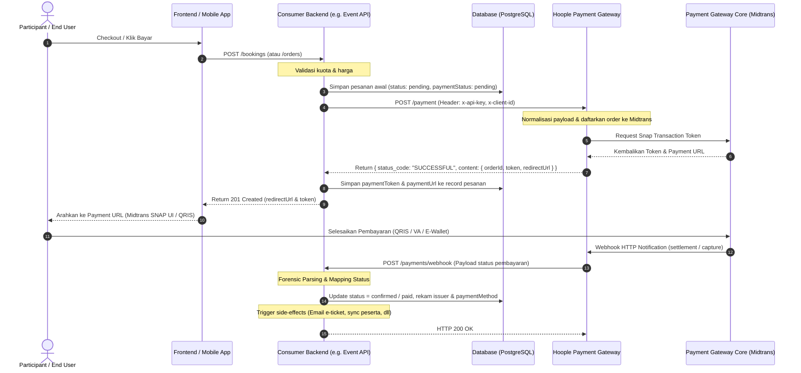
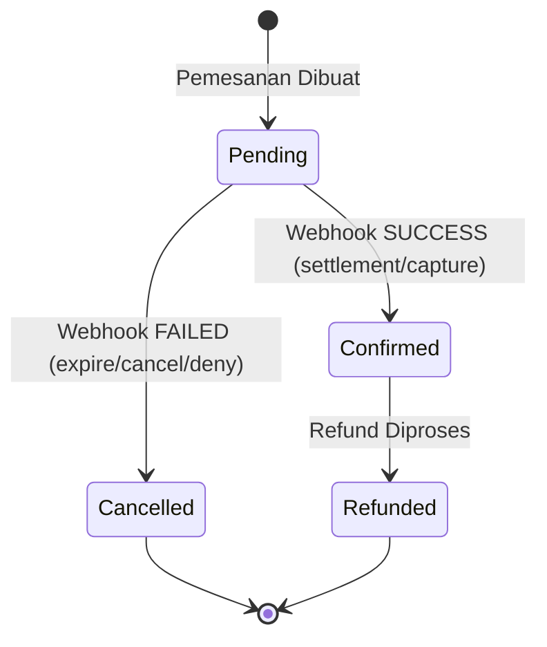

# Hoople Payment Gateway — Standalone Integration Specification & Blueprint

Dokumen ini berisi spesifikasi teknis lengkap, arsitektur, data contract, state machine, format webhook, skema database, serta template implementasi kode *drop-in* (TypeScript/Express) untuk **Hoople Payment Service**. File ini didesain sebagai panduan mandiri (*self-contained blueprint*) sehingga dapat langsung di-copy dan diintegrasikan ke proyek backend mana pun di ekosistem Hoople.

---

## Daftar Isi
1. [Arsitektur & Topologi Sistem](#1-arsitektur--topologi-sistem)
2. [Environment Variables & Autentikasi](#2-environment-variables--autentikasi)
3. [Spesifikasi Endpoint Outgoing (Client Service)](#3-spesifikasi-endpoint-outgoing-client-service)
   - 3.1 [Create Payment (`POST /payment`)](#31-create-payment-post-payment)
   - 3.2 [Check Payment Status (`POST /payment/status`)](#32-check-payment-status-post-paymentstatus)
   - 3.3 [Refund Payment (`POST /payment/refund`)](#33-refund-payment-post-paymentrefund)
4. [Spesifikasi Webhook Inbound Engine (`POST /payments/webhook`)](#4-spesifikasi-webhook-inbound-engine-post-paymentswebhook)
   - 4.1 [Payload Polymorphism & Field Resolution Ladder](#41-payload-polymorphism--field-resolution-ladder)
   - 4.2 [Status Resolution & Categorization Matrix](#42-status-resolution--categorization-matrix)
   - 4.3 [Payment Method & Issuer Extraction](#43-payment-method--issuer-extraction)
   - 4.4 [State Machine & Post-Payment Side Effects](#44-state-machine--post-payment-side-effects)
5. [Skema Database & Persistence Model](#5-skema-database--persistence-model)
6. [Drop-in Implementation Code (TypeScript / Express)](#6-drop-in-implementation-code-typescript--express)
   - 6.1 [Type Definitions (`types/payment.ts`)](#61-type-definitions-typespaymentts)
   - 6.2 [Service Layer (`services/hooplePaymentService.ts`)](#62-service-layer-serviceshooplepaymentservicets)
   - 6.3 [Controller Layer (`controllers/paymentController.ts`)](#63-controller-layer-controllerspaymentcontrollerts)
   - 6.4 [Router Definition (`routes/payments.ts`)](#64-router-definition-routespaymentsts)
7. [Testing & Sandbox Simulation (cURL Collection)](#7-testing--sandbox-simulation-curl-collection)
8. [Production Best Practices & Checklist](#8-production-best-practices--checklist)

---

## 1. Arsitektur & Topologi Sistem

Hoople Payment Gateway Service (`api-payment.hoople.co.id` / `dev-api-payment.hoople.co.id`) adalah payment aggregator/orchestrator internal terpusat yang membungkus payment gateway upstream (Midtrans SNAP, QRIS, Virtual Account, E-Wallet).

Aplikasi downstream (misal: Event API, Merchandise API, Subscription Service) berkomunikasi dengan Hoople Payment Service melalui **Direct Service-to-Service REST API** dan menerima pembaruan status transaksi asinkron melalui **HTTP Webhook Callback**.

### 1.1 Sequence Diagram: Siklus Transaksi Pembayaran



---

## 2. Environment Variables & Autentikasi

Setiap proyek yang mengintegrasikan Hoople Payment wajib mendefinisikan variabel lingkungan berikut:

```env
# URL Hoople Payment Service
# Development: https://dev-api-payment.hoople.co.id
# Production:  https://api-payment.hoople.co.id
HOOPLE_PAYMENT_URL=https://dev-api-payment.hoople.co.id

# Kredensial API Client
HOOPLE_PAYMENT_API_KEY=HoPay-CLIENT-SECRETKEY123456
HOOPLE_PAYMENT_CLIENT_ID=00000000-0000-0000-0000-000000000000

# Endpoint Callback Webhook di aplikasi Anda
HOOPLE_PAYMENT_CALLBACK_URL=https://api.yourdomain.com/payments/webhook

# URL Redirect ketika pengguna menyelesaikan pembayaran di browser
HOOPLE_PAYMENT_FINISH_URL=https://yourdomain.com/booking/finish

# Fee Opsional (jika kalkulasi harga dilakukan di backend)
HOOPLE_PLATFORM_FEE=0
HOOPLE_PAYMENT_GATEWAY_FEE=0
```

### 2.1 Header Autentikasi Wajib (Service-to-Service)
Setiap panggilan *outgoing* dari aplikasi ke Hoople Payment Service wajib menyertakan 3 header:
1. `x-api-key`: API Key yang diterbitkan oleh Hoople Payment Admin (format: `HoPay-<PLATFORM>-<SECRET>`).
2. `x-client-id`: UUID Client Application yang terdaftar di database Hoople Payment.
3. `Content-Type`: `application/json`.

---

## 3. Spesifikasi Endpoint Outgoing (Client Service)

### 3.1 Create Payment (`POST /payment`)
Digunakan untuk mendaftarkan transaksi baru dan menghasilkan payment token serta redirect URL checkout.

- **URL**: `${HOOPLE_PAYMENT_URL}/payment`
- **Method**: `POST`
- **Headers**:
  ```http
  x-api-key: <HOOPLE_PAYMENT_API_KEY>
  x-client-id: <HOOPLE_PAYMENT_CLIENT_ID>
  Content-Type: application/json
  ```

#### Request Payload
```json
{
  "items": [
    {
      "id": "item-ticket-uuid-123",
      "name": "Workshop Artificial Intelligence",
      "quantity": 1,
      "price": 150000
    }
  ],
  "amount": 150000,
  "customerName": "Budi Santoso",
  "customerEmail": "budi@example.com",
  "customerPhone": "081234567890",
  "paymentMethod": "other_qris",
  "callbackUrl": "https://api.yourdomain.com/payments/webhook",
  "finishUrl": "https://yourdomain.com/booking/finish"
}
```

#### Aturan & Constraint Penting:
1. **Item Name Truncation**: Midtrans membatasi panjang nama item maksimal 50 karakter. Wajib lakukan `.slice(0, 50)` sebelum dikirim:
   ```ts
   name: (title || 'Experience Ticket').slice(0, 50)
   ```
2. **Normalisasi Payment Method**:
   Jika aplikasi internal menggunakan format `pm-qris` atau `pm-bca-va`, wajib dinormalisasi:
   - Buang prefix `pm-`
   - Ganti `-` menjadi `_`
   - Khusus `qris` diubah menjadi `other_qris` (sesuai spesifikasi Midtrans/Hoople Payment):
   ```ts
   const normalizePaymentMethod = (id?: string) => {
     if (!id) return undefined;
     const normalized = id.replace(/^pm-/, '').replace(/-/g, '_');
     if (normalized === 'qris') return 'other_qris';
     return normalized;
   };
   ```
3. **Daftar `paymentMethod` yang Didukung**:
   - **QRIS**: `other_qris`
   - **Virtual Account**: `bca_va`, `bni_va`, `bri_va`, `cimb_va`, `permata_va`, `other_va`
   - **E-Wallet**: `gopay`, `shopeepay`
   - **Credit Card**: `credit_card`
   - **Paylater**: `akulaku`, `kredivo`
   - **Retail**: `indomaret`
   - **Direct Debit**: `danamon_online`, `uob_ezpay`

#### Response Success (`200 OK` / `201 Created`)
```json
{
  "status_code": "SUCCESSFUL",
  "message": "Payment created successfully",
  "content": {
    "orderId": "HP12607280001",
    "token": "4b684841-8669-42b7-a365-538053744652",
    "redirectUrl": "https://merchant-dev.pvpg.co.id:7977/v2/payment?id=4b684841-8669-42b7-a365-538053744652",
    "amount": 150000
  }
}
```

#### Penanganan Error
- Jika response `status_code !== 'SUCCESSFUL'` atau HTTP status `>= 400`:
  - Lempar domain error `PAYMENT_GATEWAY_ERROR` dengan status HTTP 502 (Bad Gateway) atau status dari upstream jika 4xx.
  - Jangan fallback ke link mockup / fiktif di production.

---

### 3.2 Check Payment Status (`POST /payment/status`)
Digunakan untuk query status pembayaran secara langsung (misal untuk job rekonsiliasi berkala atau polling fallback jika webhook terlambat).

- **URL**: `${HOOPLE_PAYMENT_URL}/payment/status`
- **Method**: `POST`
- **Request Body**:
  ```json
  {
    "orderId": "HP12607280001"
  }
  ```

#### Response Example
```json
{
  "status_code": "SUCCESSFUL",
  "data": {
    "orderId": "HP12607280001",
    "transactionStatus": "settlement",
    "paymentStatus": "SUCCESS",
    "amount": 150000,
    "paymentType": "qris",
    "issuer": "gopay",
    "transactionTime": "2026-11-06 10:45:12"
  }
}
```

---

### 3.3 Refund Payment (`POST /payment/refund`)
Digunakan untuk memproses pengembalian dana sebagian (*partial refund*) atau penuh (*full refund*).

- **URL**: `${HOOPLE_PAYMENT_URL}/payment/refund`
- **Method**: `POST`
- **Request Body**:
  ```json
  {
    "orderId": "HP12607280001",
    "amount": 50000,
    "reason": "Pembatalan acara oleh panitia",
    "refundKey": "REFUND-HP12607280001-01"
  }
  ```

#### Aturan Semantik Refund:
- **Partial Refund** (`amount < total`): Status transaksi tetap `SUCCESS`, namun catatan histori refund dicatat di gateway.
- **Full Refund** (`amount === total`): Status transaksi akan berubah menjadi `REFUNDED`.

---

## 4. Spesifikasi Webhook Inbound Engine (`POST /payments/webhook`)

Webhook endpoint adalah gerbang penerimaan notifikasi status pembayaran dari Hoople Payment Gateway. Karena format payload di lingkungan production/staging sering bervariasi (flat payload, nested gateway payload, camelCase vs snake_case, wrapper payload), engine webhook didesain dengan **Resilient Forensic Resolution**.

### 4.1 Payload Polymorphism & Field Resolution Ladder

Sistem harus memeriksa field identifier dengan urutan prioritas (*fallback ladder*):

```ts
const orderId =
  body.orderId ||
  body.order_id ||
  body.bookingId ||
  body.booking_id ||
  body.id ||
  body.content?.orderId ||
  body.content?.order_id ||
  body.gateway?.orderId ||
  body.gateway?.order_id ||
  body.content?.midtrans?.order_id ||
  body.midtrans?.order_id;
```

### 4.2 Status Resolution & Categorization Matrix

Kumpulkan semua string kandidat status dari setiap layer payload, trim dan ubah ke UPPERCASE:
```ts
const rawCandidates: string[] = [
  body.status,
  body.paymentStatus,
  body.payment_status,
  body.bookingStatus,
  body.booking_status,
  body.transaction_status,
  body.newStatus,
  body.gateway?.payment_status,
  body.gateway?.transaction_status,
  body.gateway?.status,
  body.content?.paymentStatus,
  body.content?.midtransStatus,
  body.content?.midtrans?.transaction_status,
  body.content?.status,
  body.midtrans?.transaction_status,
].filter(Boolean).map((s) => String(s).trim().toUpperCase());
```

Kategorikan status ke dalam 4 domain state utama berdasarkan tabel berikut:

| Kategori State | Set Nilai String Mentah (*Raw Candidate Match*) | State Akhir Pesanan | State Akhir Pembayaran |
|---|---|---|---|
| **SUCCESS** | `SUCCESS`, `SUCCESSFUL`, `SETTLEMENT`, `CAPTURE`, `PAID`, `CONFIRMED`, `COMPLETED`, `COMPLETE`, `ACCEPT`, `ACCEPTED`, `APPROVED`, `00`, `200` | `confirmed` | `paid` |
| **REFUNDED** | `REFUND`, `REFUNDED` | `refunded` | `refunded` |
| **FAILED** | `FAILED`, `FAILURE`, `FAIL`, `DENY`, `DENIED`, `CANCEL`, `CANCELLED`, `CANCELED`, `EXPIRE`, `EXPIRED`, `REJECT`, `REJECTED` | `cancelled` | `failed` |
| **PENDING** | `PENDING`, `UNPAID`, `WAITING`, `CHALLENGE`, `AUTHORIZE`, `AUTHORIZED` | `pending` | `pending` |

Urutan evaluasi logika:
```ts
let status = rawCandidates[0] || '';
if (rawCandidates.some((c) => SUCCESS_STATUSES.has(c))) {
  status = 'SUCCESS';
} else if (rawCandidates.some((c) => REFUNDED_STATUSES.has(c))) {
  status = 'REFUNDED';
} else if (rawCandidates.some((c) => FAILED_STATUSES.has(c))) {
  status = 'FAILED';
} else if (rawCandidates.some((c) => PENDING_STATUSES.has(c))) {
  status = 'PENDING';
}
```

### 4.3 Payment Method & Issuer Extraction

Ekstraksi metode pembayaran dan nama penerbit/bank (*issuer*) secara berlapis:
```ts
const paymentMethod =
  body.paymentMethod ||
  body.payment_method ||
  body.content?.paymentMethod ||
  body.content?.payment_method ||
  body.gateway?.payment_type ||
  body.gateway?.paymentMethod ||
  body.gateway?.payment_method ||
  body.midtrans?.payment_type ||
  body.content?.midtrans?.payment_type ||
  existingOrder.paymentMethodId;

const issuer =
  body.issuer ||
  body.issuer_name ||
  body.gateway?.issuer ||
  body.gateway?.issuer_name ||
  body.midtrans?.issuer ||
  body.content?.midtrans?.issuer ||
  body.content?.issuer ||
  existingOrder.issuer ||
  null;
```

### 4.4 State Machine & Post-Payment Side Effects



1. **Ketika `status === 'SUCCESS'`**:
   - Update `Booking.status = 'confirmed'` dan `Booking.paymentStatus = 'paid'`.
   - Update `Booking.paymentMethodId` dan `Booking.issuer`.
   - **Side Effect 1**: Sinkronisasi data peserta ke tabel `Participant` (generate unique QR Code per peserta).
   - **Side Effect 2**: Kirim email konfirmasi pembayaran dengan lampiran tiket PDF (*Background Job*).
2. **Ketika `status === 'FAILED'`**:
   - Update `Booking.status = 'cancelled'`, `Booking.paymentStatus = 'failed'`.
   - Rekam timestamp `cancelledAt = new Date()` dan `cancellationReason = 'Payment failed or expired'`.
   - **Side Effect**: Bersihkan akun guest/auto-created user yang dibuat sementara saat checkout:
     ```ts
     if (meta?.autoCreatedUsers?.length) {
       await prisma.user.deleteMany({ where: { email: { in: emailsToDelete } } });
     }
     ```
3. **Ketika `status === 'REFUNDED'`**:
   - Update `Booking.status = 'refunded'`, `Booking.paymentStatus = 'refunded'`.

---

## 5. Skema Database & Persistence Model

Di bawah ini adalah referensi model Prisma untuk entitas pesanan yang terintegrasi dengan Hoople Payment:

```prisma
model Booking {
  id                 String    @id @default(uuid())
  orderId            String    @unique @default(uuid()) // Identifier pesanan di Hoople Pay
  ticketId           String    @unique @default(uuid())
  status             String    @default("pending")      // "pending" | "confirmed" | "cancelled" | "refunded"
  paymentStatus      String    @default("pending")      // "pending" | "paid" | "failed" | "refunded"
  quantity           Int
  buyerName          String
  buyerEmail         String
  buyerPhone         String
  paymentMethodId    String                             // e.g. "other_qris", "bca_va"
  issuer             String?                            // e.g. "bca", "gopay", "shopee"
  paymentToken       String?                            // Token SNAP Midtrans
  paymentUrl         String?                            // URL checkout redirect
  totalAmount        Int?                               // Nominal tagihan final
  createdAt          DateTime  @default(now())
  updatedAt          DateTime  @updatedAt
  cancelledAt        DateTime?
  cancellationReason String?
  meta               Json?                              // Payload metadata tambahan

  @@index([orderId])
  @@index([buyerEmail])
  @@index([status])
  @@index([paymentStatus])
}
```

---

## 6. Drop-in Implementation Code (TypeScript / Express)

File-file di bawah ini dapat langsung di-copy ke folder proyek Anda.

### 6.1 Type Definitions (`types/payment.ts`)

```typescript
export interface PaymentItem {
  id: string;
  name: string;
  quantity: number;
  price: number;
}

export interface CreatePaymentParams {
  orderId: string;
  items: PaymentItem[];
  amount: number;
  customerName: string;
  customerEmail: string;
  customerPhone: string;
  paymentMethodId?: string;
}

export interface CreatePaymentResult {
  orderId: string;
  token: string;
  redirectUrl: string;
  amount: number;
}

export interface RefundParams {
  orderId: string;
  amount: number;
  reason?: string;
  refundKey?: string;
}

export interface WebhookResult {
  orderId: string;
  status: 'SUCCESS' | 'FAILED' | 'REFUNDED' | 'PENDING' | string;
  bookingStatus: string;
  paymentStatus: string;
}
```

---

### 6.2 Service Layer (`services/hooplePaymentService.ts`)

```typescript
import { PrismaClient } from '@prisma/client';
import { CreatePaymentParams, CreatePaymentResult, RefundParams, WebhookResult } from '../types/payment';

const prisma = new PrismaClient();

const getPaymentConfig = () => {
  const url = process.env.HOOPLE_PAYMENT_URL;
  const apiKey = process.env.HOOPLE_PAYMENT_API_KEY;
  const clientId = process.env.HOOPLE_PAYMENT_CLIENT_ID;
  const callbackUrl = process.env.HOOPLE_PAYMENT_CALLBACK_URL;
  const finishUrl = process.env.HOOPLE_PAYMENT_FINISH_URL;

  if (!url || !apiKey || !clientId) {
    throw {
      status: 500,
      code: 'SERVER_ERROR',
      message: 'Hoople Payment configuration is missing (URL, API key, or Client ID)',
    };
  }

  return { url, apiKey, clientId, callbackUrl, finishUrl };
};

/**
 * 1. Create Payment Transaction on Hoople Payment Gateway
 */
export const createPayment = async (params: CreatePaymentParams): Promise<CreatePaymentResult> => {
  const config = getPaymentConfig();

  // Normalize paymentMethod (e.g. pm-qris -> other_qris)
  const normalizedPaymentMethod = (() => {
    if (!params.paymentMethodId) return undefined;
    const norm = params.paymentMethodId.replace(/^pm-/, '').replace(/-/g, '_');
    return norm === 'qris' ? 'other_qris' : norm;
  })();

  // Item name truncated to max 50 chars for gateway compatibility
  const sanitizedItems = params.items.map((item) => ({
    ...item,
    name: item.name.slice(0, 50),
  }));

  const response = await fetch(`${config.url}/payment`, {
    method: 'POST',
    headers: {
      'x-api-key': config.apiKey,
      'x-client-id': config.clientId,
      'Content-Type': 'application/json',
    },
    body: JSON.stringify({
      items: sanitizedItems,
      amount: params.amount,
      customerName: params.customerName,
      customerEmail: params.customerEmail,
      customerPhone: params.customerPhone,
      paymentMethod: normalizedPaymentMethod,
      callbackUrl: config.callbackUrl,
      finishUrl: config.finishUrl,
    }),
  });

  if (!response.ok) {
    const errText = await response.text();
    console.error('[Hoople Payment Service] API Error:', errText);
    throw {
      status: response.status >= 400 && response.status < 500 ? response.status : 502,
      code: 'PAYMENT_GATEWAY_ERROR',
      message: `Payment gateway responded with status ${response.status}: ${errText}`,
    };
  }

  const json = (await response.json()) as any;
  if (json.status_code === 'SUCCESSFUL' && json.content) {
    return {
      orderId: json.content.orderId,
      token: json.content.token,
      redirectUrl: json.content.redirectUrl,
      amount: json.content.amount,
    };
  }

  throw {
    status: 502,
    code: 'PAYMENT_GATEWAY_ERROR',
    message: json.message || 'Payment API returned unsuccessful status_code',
  };
};

/**
 * 2. Check Payment Status by Order ID
 */
export const checkPaymentStatus = async (orderId: string): Promise<any> => {
  const config = getPaymentConfig();

  const response = await fetch(`${config.url}/payment/status`, {
    method: 'POST',
    headers: {
      'x-api-key': config.apiKey,
      'x-client-id': config.clientId,
      'Content-Type': 'application/json',
    },
    body: JSON.stringify({ orderId }),
  });

  if (!response.ok) {
    const errText = await response.text();
    throw {
      status: response.status >= 400 && response.status < 500 ? response.status : 502,
      code: 'PAYMENT_GATEWAY_ERROR',
      message: `Check Payment Status API responded with status ${response.status}: ${errText}`,
    };
  }

  const json = (await response.json()) as any;
  return json.data || json;
};

/**
 * 3. Process Refund for a Payment
 */
export const refundPayment = async (params: RefundParams): Promise<any> => {
  const config = getPaymentConfig();

  const response = await fetch(`${config.url}/payment/refund`, {
    method: 'POST',
    headers: {
      'x-api-key': config.apiKey,
      'x-client-id': config.clientId,
      'Content-Type': 'application/json',
    },
    body: JSON.stringify(params),
  });

  if (!response.ok) {
    const errText = await response.text();
    throw {
      status: response.status >= 400 && response.status < 500 ? response.status : 502,
      code: 'PAYMENT_GATEWAY_ERROR',
      message: `Refund API responded with status ${response.status}: ${errText}`,
    };
  }

  const json = (await response.json()) as any;
  return json.content || json;
};

/**
 * 4. Forensic Inbound Webhook Processor
 */
export const processPaymentWebhook = async (body: any): Promise<WebhookResult> => {
  console.log('[Hoople Payment Webhook] Received body:', JSON.stringify(body, null, 2));

  // Multi-property extraction for order identifier
  const orderId =
    body.orderId ||
    body.order_id ||
    body.bookingId ||
    body.booking_id ||
    body.id ||
    body.content?.orderId ||
    body.content?.order_id ||
    body.gateway?.orderId ||
    body.gateway?.order_id ||
    body.content?.midtrans?.order_id ||
    body.midtrans?.order_id;

  // Multi-candidate status resolution
  const rawCandidates: string[] = [
    body.status,
    body.paymentStatus,
    body.payment_status,
    body.bookingStatus,
    body.booking_status,
    body.transaction_status,
    body.newStatus,
    body.gateway?.payment_status,
    body.gateway?.transaction_status,
    body.gateway?.status,
    body.content?.paymentStatus,
    body.content?.midtransStatus,
    body.content?.midtrans?.transaction_status,
    body.content?.status,
    body.midtrans?.transaction_status,
  ].filter(Boolean).map((s) => String(s).trim().toUpperCase());

  const SUCCESS_SET = new Set([
    'SUCCESS', 'SUCCESSFUL', 'SETTLEMENT', 'CAPTURE', 'PAID', 'CONFIRMED',
    'COMPLETED', 'COMPLETE', 'ACCEPT', 'ACCEPTED', 'APPROVED', '00', '200'
  ]);
  const FAILED_SET = new Set([
    'FAILED', 'FAILURE', 'FAIL', 'DENY', 'DENIED', 'CANCEL', 'CANCELLED',
    'CANCELED', 'EXPIRE', 'EXPIRED', 'REJECT', 'REJECTED'
  ]);
  const REFUNDED_SET = new Set(['REFUND', 'REFUNDED']);
  const PENDING_SET = new Set(['PENDING', 'UNPAID', 'WAITING', 'CHALLENGE', 'AUTHORIZE', 'AUTHORIZED']);

  let status = rawCandidates[0] || '';
  if (rawCandidates.some((c) => SUCCESS_SET.has(c))) {
    status = 'SUCCESS';
  } else if (rawCandidates.some((c) => REFUNDED_SET.has(c))) {
    status = 'REFUNDED';
  } else if (rawCandidates.some((c) => FAILED_SET.has(c))) {
    status = 'FAILED';
  } else if (rawCandidates.some((c) => PENDING_SET.has(c))) {
    status = 'PENDING';
  }

  if (!orderId || !status) {
    throw {
      status: 422,
      code: 'VALIDATION_ERROR',
      message: 'Missing required orderId or status in webhook payload',
      errors: { orderId: ['orderId and status could not be resolved'] },
    };
  }

  // Find record in DB
  const booking = await prisma.booking.findFirst({
    where: {
      OR: [
        { orderId },
        { id: orderId },
        { ticketId: orderId },
      ],
    },
  });

  if (!booking) {
    throw {
      status: 404,
      code: 'NOT_FOUND',
      message: `Booking not found for orderId: ${orderId}`,
      errors: { orderId: ['No record matching orderId'] },
    };
  }

  let bookingStatus = booking.status;
  let paymentStatus = booking.paymentStatus;
  let cancelledAt = booking.cancelledAt;
  let cancellationReason = booking.cancellationReason;

  const paymentMethod =
    body.paymentMethod ||
    body.payment_method ||
    body.content?.paymentMethod ||
    body.gateway?.payment_type ||
    booking.paymentMethodId;

  const issuer =
    body.issuer ||
    body.issuer_name ||
    body.gateway?.issuer ||
    body.content?.issuer ||
    booking.issuer ||
    null;

  if (status === 'SUCCESS') {
    bookingStatus = 'confirmed';
    paymentStatus = 'paid';
  } else if (status === 'FAILED') {
    bookingStatus = 'cancelled';
    paymentStatus = 'failed';
    cancelledAt = new Date();
    cancellationReason = 'Payment failed or expired';
  } else if (status === 'REFUNDED') {
    bookingStatus = 'refunded';
    paymentStatus = 'refunded';
  } else if (status === 'PENDING') {
    bookingStatus = 'pending';
    paymentStatus = 'pending';
  }

  const updatedBooking = await prisma.booking.update({
    where: { id: booking.id },
    data: {
      status: bookingStatus,
      paymentStatus,
      paymentMethodId: paymentMethod,
      issuer,
      cancelledAt,
      cancellationReason,
    },
  });

  // Post-payment trigger hooks (Execute async without blocking HTTP response)
  if (status === 'SUCCESS') {
    setImmediate(async () => {
      // 1. Participant Sync / QR Code Generation
      // 2. Email confirmation dispatch
      console.log(`[Webhook Success] Triggering post-payment tasks for ${updatedBooking.id}`);
    });
  }

  return {
    orderId,
    status,
    bookingStatus: updatedBooking.status,
    paymentStatus: updatedBooking.paymentStatus,
  };
};
```

---

### 6.3 Controller Layer (`controllers/paymentController.ts`)

```typescript
import { Request, Response, NextFunction } from 'express';
import * as hooplePaymentService from '../services/hooplePaymentService';

export const handlePaymentWebhook = async (req: Request, res: Response, next: NextFunction): Promise<void> => {
  try {
    const data = await hooplePaymentService.processPaymentWebhook(req.body);

    res.status(200).json({
      success: true,
      message: 'Webhook processed successfully',
      data,
      meta: null,
      error: null,
    });
  } catch (error: any) {
    if (error.status && error.code) {
      res.status(error.status).json({
        success: false,
        message: error.message || 'Validation failed',
        data: null,
        meta: null,
        error: { code: error.code, errors: error.errors || {} },
      });
      return;
    }

    console.error('[Payment Controller] Webhook error:', error);
    res.status(500).json({
      success: false,
      message: 'An unexpected error occurred during webhook processing',
      data: null,
      meta: null,
      error: { code: 'SERVER_ERROR', errors: {} },
    });
  }
};
```

---

### 6.4 Router Definition (`routes/payments.ts`)

```typescript
import { Router } from 'express';
import { handlePaymentWebhook } from '../controllers/paymentController';

const router = Router();

// Public webhook route (Exempt from JWT token authentication)
router.post('/webhook', handlePaymentWebhook);

export default router;
```

Di file inisialisasi Express aplikasi Anda (`app.ts` atau `index.ts`):
```typescript
import paymentsRouter from './routes/payments';

app.use('/payments', paymentsRouter);
```

---

## 7. Testing & Sandbox Simulation (cURL Collection)

### 7.1 Create Payment Simulation
```bash
curl -X POST "https://dev-api-payment.hoople.co.id/payment" \
  -H "x-api-key: HoPay-CLIENT-SECRETKEY123456" \
  -H "x-client-id: 00000000-0000-0000-0000-000000000000" \
  -H "Content-Type: application/json" \
  -d '{
    "items": [
      {
        "id": "TICKET-001",
        "name": "General Admission Pass",
        "quantity": 1,
        "price": 100000
      }
    ],
    "amount": 100000,
    "customerName": "Test Buyer",
    "customerEmail": "testbuyer@example.com",
    "customerPhone": "08123456789",
    "paymentMethod": "other_qris",
    "callbackUrl": "https://api.yourdomain.com/payments/webhook",
    "finishUrl": "https://yourdomain.com/booking/finish"
  }'
```

### 7.2 Simulasi Webhook: Pembayaran Sukses (Settlement)
```bash
curl -X POST "http://localhost:3000/payments/webhook" \
  -H "Content-Type: application/json" \
  -d '{
    "orderId": "HP12607280001",
    "status": "SETTLEMENT",
    "paymentMethod": "other_qris",
    "gateway": {
      "transaction_id": "89ab12cd-e89b-12d3-a456-426614174000",
      "transaction_status": "settlement",
      "orderId": "HP12607280001",
      "payment_status": "SUCCESS",
      "issuer": "gopay"
    }
  }'
```

### 7.3 Simulasi Webhook: Pembayaran Expired / Gagal
```bash
curl -X POST "http://localhost:3000/payments/webhook" \
  -H "Content-Type: application/json" \
  -d '{
    "orderId": "HP12607280001",
    "status": "EXPIRE",
    "gateway": {
      "transaction_status": "expire",
      "payment_status": "FAILED"
    }
  }'
```

---

## 8. Production Best Practices & Checklist

- [ ] **Credential Safety**: Simpan `HOOPLE_PAYMENT_API_KEY` dan `HOOPLE_PAYMENT_CLIENT_ID` secara aman di vault atau secret manager; jangan pernah hardcode di repositori git.
- [ ] **Public Route**: Pastikan endpoint `/payments/webhook` tidak terkunci oleh middleware JWT/Bearer token karena dipanggil langsung oleh server Hoople Payment Gateway.
- [ ] **Strict Status Verification**: Gunakan Set `SUCCESS_SET` dan `FAILED_SET` lengkap untuk mencegah kegagalan rekonsiliasi akibat variasi penamaan status antar payment channel.
- [ ] **Idempotency**: Pastikan operasi webhook bersifat idempoten. Jika webhook yang sama dikirim berulang kali (karena retry dari payment gateway), state record di database tidak rusak dan email konfirmasi tidak dikirim berkali-kali.
- [ ] **Item Name Constraint**: Selalu batasi nama item maksimal 50 karakter (`.slice(0, 50)`) untuk menghindari penolakan transaksi oleh Midtrans.
- [ ] **Non-blocking Post Actions**: Jalankan pengiriman email, sinkronisasi data peserta, dan penghapusan guest account dalam background process/queue (`setImmediate` atau message queue seperti BullMQ/Redis) agar webhook controller selalu merespons HTTP 200 dalam waktu `< 500ms`.

## 9. Payment Methods Catalog

| Canonical ID  | Name        | Category    | Recommended | Midtrans ID   | App A ID      | App B ID      | PVS ID |
| ------------- | ----------- | ----------- | ----------- | ------------- | ------------- | ------------- | ------ |
| `credit_card` | Credit Card | card        | No          | `credit_card` | `credit_card` | `credit_card` | -      |
| `permata_va`  | Permata VA  | va          | No          | `permata_va`  | `permata_va`  | -             | -      |
| `bca_va`      | BCA VA      | va          | No          | `bca_va`      | `bca_va`      | -             | -      |
| `bni_va`      | BNI VA      | va          | No          | `bni_va`      | `bni_va`      | -             | -      |
| `bri_va`      | BRI VA      | va          | No          | `bri_va`      | `bri_va`      | -             | -      |
| `cimb_va`     | CIMB VA     | va          | No          | `cimb_va`     | `cimb_va`     | -             | -      |
| `other_va`    | Other VA    | va          | No          | `other_va`    | `other_va`    | -             | -      |
| `gopay`       | GoPay       | ewallet     | **Yes**     | `gopay`       | `gopay`       | `gopay`       | -      |
| `shopeepay`   | ShopeePay   | ewallet     | No          | `shopeepay`   | `shopeepay`   | `shopeepay`   | -      |
| `indomaret`   | Indomaret   | convenience | No          | `indomaret`   | `indomaret`   | -             | -      |
| `akulaku`     | Akulaku     | paylater    | No          | `akulaku`     | `akulaku`     | -             | -      |
| `kredivo`     | Kredivo     | paylater    | No          | `kredivo`     | `kredivo`     | -             | -      |
| `uob_ezpay`   | UOB EZPay   | paylater    | No          | `uob_ezpay`   | `uob_ezpay`   | -             | -      |
| `qris`        | QRIS        | qris        | **Yes**     | `other_qris`  | `qris`        | `qris`        | `qris` |

